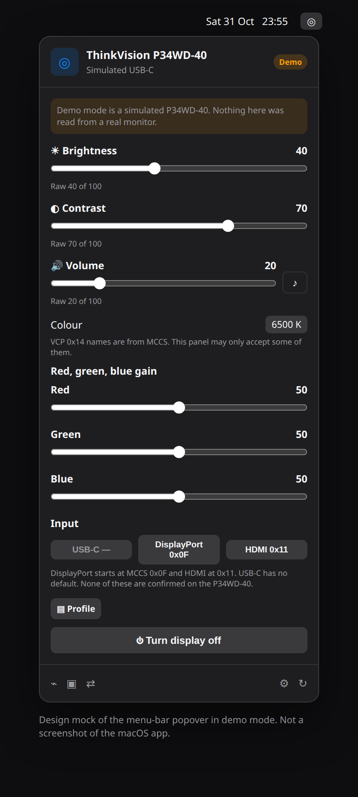

# ThinkDial

ThinkDial is a macOS menu-bar app for a Lenovo ThinkVision P34WD-40. It sends standard DDC/CI commands so brightness, contrast, volume, colour, and input can be changed without the monitor’s on-screen menu.

The name is ThinkDial: a dial for a ThinkVision, and not a Lenovo product. PanelPilot was the other candidate.



Apple Silicon is the path that matters. DDC goes through [AppleSiliconDDC](https://github.com/waydabber/AppleSiliconDDC) (MIT). Intel Macs get a smaller IOFramebuffer I2C fallback, informed by the public transaction shape in [MonitorControl](https://github.com/MonitorControl/MonitorControl)’s `Arm64DDC.swift` / Intel path (MIT). That fallback is compiled into the arm64 build so it is typechecked, and it runs only when `AppleSiliconDDC.isArm64` is false.

## Requirements

- macOS 13 or later
- An Apple silicon Mac for the primary DDC path
- The P34WD-40 connected by **USB-C or DisplayPort**
- Xcode 15 or later, if you are building it yourself

## Connect the monitor

1. In the monitor’s on-screen menu, turn **DDC/CI on** if the panel has that toggle (often under System or Options). The P34WD-40 advertises DDC/CI; the exact menu title depends on the firmware.
2. Use the USB-C upstream port or a DisplayPort input. Those are the connections that can carry DDC.
3. **M1 HDMI.** The open-source AppleSiliconDDC library does not include full M1 HDMI support (waydabber has said some of that lives only in BetterDisplay). On an M1, prefer USB-C or DisplayPort. Later Apple silicon HDMI is still less reliable than DisplayPort for DDC.
4. **DisplayLink docks** do not pass DDC. A dock that uses DisplayLink will show a picture and ignore these controls. Plug the monitor in directly, or use a dock that is a real USB-C / DisplayPort alt-mode connection.

## Run it

Demo mode needs no monitor. Turn it on from the empty popover, or in Settings → General. The demo is a simulated P34WD-40 plus a second display so the picker is visible. Its capabilities string contains `SIMULATED` and the model name `ThinkDialSim`. It is not a dump from Lenovo hardware.

```bash
swift test

swift build -c release --arch arm64 --package-path App
Scripts/package-app.sh App/.build/arm64-apple-macosx/release/ThinkDial
```

`Scripts/package-app.sh` builds `dist/ThinkDial.app` (Info.plist, `LSUIElement`, bundle id `app.thinkdial.ThinkDial`, icon), ad-hoc signs it, and zips it. The first launch of an ad-hoc signed app may need a right-click → Open. Launch at login uses `SMAppService` and expects that `.app` bundle.

Opening the `App` folder in `xcodebuild` does not create a ThinkDial scheme (the synthesized workspace is named `App` and its scheme list is empty). CI prints `xcodebuild -list` so that stays visible, then builds with `swift build`.

The menu-bar icon is the SF Symbol `dial.medium`. The app is an agent (`LSUIElement`), so it does not take a Dock icon. Brightness and volume keys stay with macOS until you opt in under Settings → Keys, which asks for Accessibility permission because those keys are otherwise hidden.

Shortcuts can set brightness, apply a profile, and switch a saved input. The intents launch ThinkDial if it is not running. Power-off asks for confirmation inside Shortcuts.

## What the menus do

- Brightness (VCP 0x10), contrast (0x12), volume (0x62), and mute (0x8D, MCCS 0x01 mute / 0x02 unmute).
- Colour preset (0x14) with the MCCS names (sRGB, 6500 K, user slots, and the rest). Add or delete entries in Settings.
- Red / green / blue gain (0x16 / 0x18 / 0x1A).
- USB-C, DisplayPort, and HDMI buttons. The values are editable.
- Display power off writes 0xD6 = 0x05, the MCCS “turn the display off” value, after a confirmation. Waking the panel again often needs its power button.
- A probe window: on Intel, a framebuffer I2C capabilities read; on Apple Silicon, getvcp for 0x00–0xFF (AppleSiliconDDC does not expose the capabilities opcode). Labels and pinned slider / toggle / picker controls. Export and import is JSON. Writes on that screen stay off until you arm them and confirm the specific value.
- An input tester that sends one 0x60 candidate at a time, with a warning that the Mac may lose the picture and DDC with it.
- Profiles (Coding, Movie, Night, plus ones you capture) that write several codes in order.
- A brightness schedule by clock time, or by sunrise and sunset if you type a latitude and longitude. No location permission. The schedule waits two minutes after you move the slider.
- Several displays. A Lenovo whose product name contains P34WD is chosen automatically. Another connected display is used only if you pick it.

Slider drags are coalesced and writes are retried on a background queue. The menu does not wait on I2C sleeps.

## What is not known about this panel

Lenovo has not published a capabilities string or a VCP list for the P34WD-40. ThinkDial does not invent one and call it fact.

| Control | What ships | Status on a P34WD-40 |
| --- | --- | --- |
| Brightness, contrast, volume, RGB gain | Standard MCCS codes | Codes are standard. This app has not been run against the panel. |
| Mute | 0x01 mute, 0x02 unmute | MCCS. Unrecognized readings are shown as unrecognized. |
| Colour preset | MCCS names for 0x14 | The panel may implement only a subset. |
| DisplayPort button | Starts at MCCS 0x0F (DisplayPort-1) | Not confirmed. Edit it. |
| HDMI button | Starts at MCCS 0x11 (HDMI-1) | Not confirmed. Edit it. |
| USB-C button | No value | There is no MCCS code for USB-C. |
| Power off | Writes 0x05 to 0xD6 | MCCS write value. Not confirmed. May not wake over DDC. |

The input tester’s other candidates, also unconfirmed on this model:

- 0x10, 0x12 — MCCS DisplayPort-2 and HDMI-2
- 0x13 and 0x14 — reported for an older Lenovo P44w-10, not for the P34WD-40
- 0x1B — used by some Dell USB-C ports, not a Lenovo measurement

If a test blanks the screen, change the input with the monitor’s buttons or from the other computer. DDC only works on the input that is showing this Mac.

## Limits

KVM, picture-by-picture, and True Split are probably not standard VCP codes. ThinkDial does not pretend to drive them. If a probe finds a code with no MCCS name, label it and pin it once you know what it does.

A full probe is hundreds of slow reads. Unsupported codes simply do not answer. A missing capabilities string is a normal result, not a failed scan.

## Tests

`swift test` covers the code that does not touch hardware: checksums and reply parsing, the capabilities parser, probe JSON, profile ordering, the sunrise/sunset schedule, display selection (Lenovo `0x30AE` → `LEN`), input defaults, write coalescing, and retries. The mock backend is the same one demo mode uses.

This repository can be tested on Linux for that core library. The menu-bar app builds on macOS. GitHub Actions on `macos-latest` runs the tests, builds an arm64 Release executable with Swift Package Manager, wraps a signed `.app`, uploads the zip, and attaches that zip to GitHub releases for tags named `v*`.

## Layout

- `Sources/ThinkDialCore` — DDC types, schedules, profiles, probe documents, mock monitor
- `App/` — SwiftUI menu-bar app, AppleSiliconDDC, and the Intel I2C fallback (`ThinkDialI2C`)
- `docs/popover-mock.png` — a drawing of the popover, not a screenshot from macOS

## Third-party software

- [AppleSiliconDDC](https://github.com/waydabber/AppleSiliconDDC) by waydabber, MIT. Pinned to commit `67ff964ab8123d9d35fadf7d8e1a7c677d31da14` because the repository has no version tags. Please mention that project if you ship a build, as its README asks.
- MonitorControl, MIT, used as the reference for how Apple Silicon DDC is framed. ThinkDial calls AppleSiliconDDC rather than vendoring MonitorControl.

## License

MIT. See [LICENSE](LICENSE).
